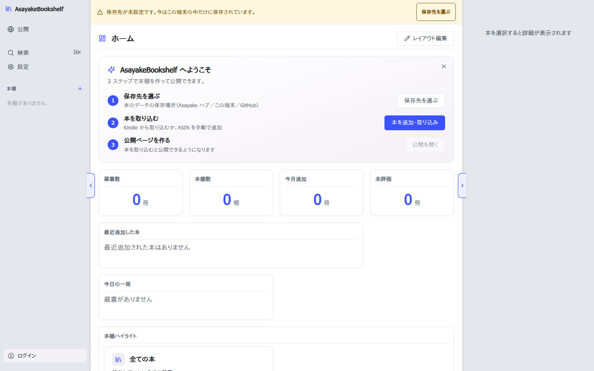
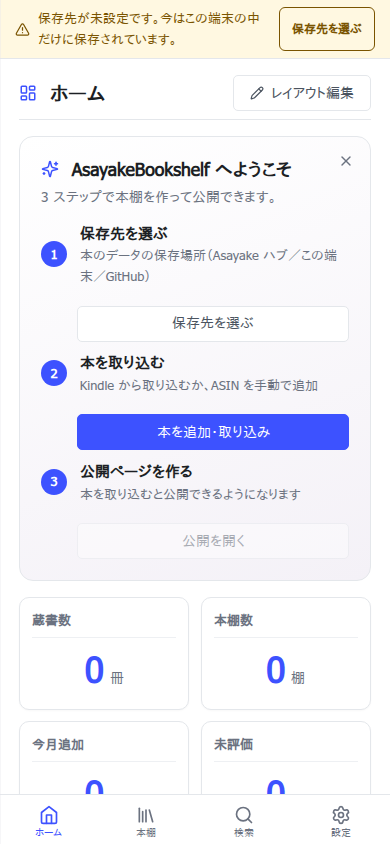
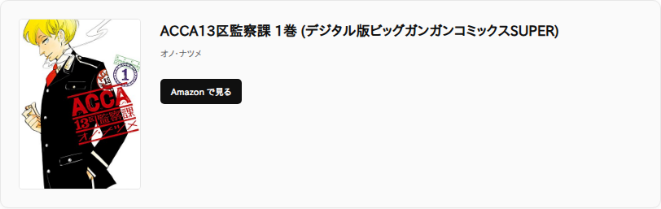

# AsayakeBookshelf


**Kindle の蔵書を本棚ごとに整理し、メモや評価を付けて、読書記録を公開できるアプリ。**

<!-- 仮の文言 (T11・イシュー#335・2026-10-24 ②判断)。コンセプトを詰める別作業で固めるまでは、
     index.html・js/publish-article-generator.js・cf-worker/top-page.js と同じ機能列挙の文言に揃える。 -->

蔵書を本棚ごとに整理し、メモや評価をつけて管理できます。プラグインで拡張でき、読んだ本を公開して共有することもできます。

👉 **今すぐ使う: https://asayake.org/bookshelf/**（登録不要・fork不要）

[karaage0703/karaage-virtual-bookshelf](https://github.com/karaage0703/karaage-virtual-bookshelf) からフォークし、全面再設計したものです。

---

## スクリーンショット

| PC ホーム | モバイル | 公開記事（本の紹介カード） |
|---|---|---|
|  |  |  |

## 特徴

- **本棚で整理** — 親子継承のある本棚に蔵書を仕分け。1冊を複数本棚に置ける
- **メモ・評価** — 本ごとに短文メモ・星評価。長文メモは Markdown で別ファイル管理
- **⌘K コマンドパレット** — 本・本棚・設定コマンドを横断検索してすぐ開く
- **カスタマイズ可能なホームダッシュボード** — ウィジェットを並べ替えて自分用のホームに
- **PWA 対応** — ホーム画面に追加してアプリのように使える（iOS / Android）
- **3通りの同期方式** — この端末だけ（PC限定）/ GitHub リポジトリ / Asayake ハブ（Google ログイン）
- **プラグインで拡張** — イベントフック・UI拡張点・GitHub からのインストール
- **読書記録を公開** — 本棚を素材に記事を書いて、固有の URL で公開・共有できる

## 使い始める（一般ユーザー向け）

**fork もアカウント登録も不要です。** [https://asayake.org/bookshelf/](https://asayake.org/bookshelf/) を開き、保存先を選ぶだけで使えます。

1. アプリを開く
2. 設定から保存先を選ぶ（下記いずれか1つ）
3. Kindle の蔵書を取り込む、または本を手動で追加する

### 保存先の選択肢

| 方式 | 対応環境 | 準備 |
|---|---|---|
| **この端末だけ**（ローカルファイル） | PC の Chrome / Edge のみ | フォルダを選ぶだけ |
| **GitHub リポジトリ** | 全環境（PC・モバイル） | GitHub アカウントでログインし、保存先リポジトリを選ぶだけ |
| **Asayake ハブ** | 全環境（PC・モバイル） | Google アカウントでログインするだけ |

いずれも登録作業は不要です（GitHub App・Google ログインは運営側で用意済みの共用クライアントを使います）。

## データとプライバシー

- 蔵書データはあなたが選んだ保存先（この端末 / あなたの GitHub リポジトリ / Asayake ハブ）にだけ保存されます。
- 「この端末だけ」「GitHub リポジトリ」を選んだ場合、運営者（アプリ提供者）はあなたのデータに一切アクセスできません。
- 「Asayake ハブ」を選んだ場合のみ、運営者が管理者としてデータを平文で預かります（同期の利便性を優先する人向けの任意の選択肢）。
- 公開は完全オプトイン。本棚を素材に記事を書いて明示的に「公開する」を押すまで、誰にも見えません。

## 自己ホストしたい人へ（補助）

このアプリは `asayake.org/bookshelf/` の1箇所でホストされており、ほとんどの人は fork する必要はありません。

自分の環境で完全に独立して動かしたい場合は、fork した上で以下を自前に用意してください:

1. GitHub App（Device Flow 対応）を登録
2. OAuth proxy 用の Cloudflare Worker をデプロイ
3. （任意）Asayake ハブ相当の課金・公開配信機能は自前では提供されないため、GitHub 同期のみの利用になります

手順の詳細は [CLAUDE.md](CLAUDE.md) の「GitHub 接続」節を参照してください。

## プラグイン開発

`plugins-sample/` にサンプル実装があります。最小スキーマ:

```json
{
  "id": "your-plugin-id",
  "name": "表示名",
  "version": "0.1.0",
  "publishable": false,
  "files": ["index.js"]
}
```

```js
// index.js
export function activate(api, manifest) {
    api.addUIButton({ id: 'hello', where: 'library-management', label: 'Hello', onClick: () => alert('hi') });
    api.on('note:updated', ({ asin, note }) => console.log('memo updated', asin, note));
}
```

API 詳細は [js/plugin-api.js](js/plugin-api.js) と [plugins-sample/README.md](plugins-sample/README.md) を参照してください。

## アーキテクチャ（開発者向け）

| ファイル | 役割 |
|---|---|
| [js/bookshelf.js](js/bookshelf.js) | メインアプリケーションクラス（UI + ビジネスロジック） |
| [js/storage.js](js/storage.js) | 同期ストレージの高レベル読み書き |
| [js/book-manager.js](js/book-manager.js) | 蔵書 CRUD |
| [js/bookshelf-manager.js](js/bookshelf-manager.js) | 本棚操作・継承・逆引きマップ |
| [js/exporter.js](js/exporter.js) | 公開エクスポート |
| [js/publish-article-generator.js](js/publish-article-generator.js) | 公開記事 HTML 生成 |
| [js/plugin-api.js](js/plugin-api.js) | プラグイン公開 API |
| [js/plugin-loader.js](js/plugin-loader.js) | プラグイン読込・GitHub install |

開発環境のセットアップ・コーディング規約は [CLAUDE.md](CLAUDE.md) を参照してください。

## モバイル

ローカルファイル保存は **PC の Chrome / Edge 限定**（File System Access API が必須）。モバイル（iOS / Android）は **GitHub 同期 / Asayake ハブ** の2択で全機能が使えます。iOS は PWA（ホーム画面に追加）で配布しています。

## クレジット・ライセンス

[karaage0703/karaage-virtual-bookshelf](https://github.com/karaage0703/karaage-virtual-bookshelf) からフォークしています。オリジナルの実装に感謝します。

本リポジトリは [MIT License](LICENSE) です。
