# bookshelf UI標準（Hallmark方式・2026-07-27 制定）

> **目的**: AIの定番パターン（生成時の癖・検証の偏り）を構造で禁止し、過去の指摘の再発を止める。
> **使い方**: ①UI を実装・変更するセッションは**冒頭でこのファイルを Read** する（生成側に効かせる）②検証はこの期待表が正（`tests/e2e/standard-ops.spec.js` が自動打鍵）③本人の指摘が出たら修正と同時に**この文書へ1行還流**する。
> **接地先**: ニールセン10ヒューリスティック / Apple HIG・Material Design（操作慣習）/ WCAG（axe-core）/ JTF日本語標準スタイルガイド＋textlint-preset-ai-writing（文言・`npm run lint:copy`）。独自ルールはこのアプリ固有の残余のみ。

## §1 標準操作の期待表（全モーダル・シート・バナー）

**原則: ユーザーが「閉じたい/戻りたい」と思ったとき、その環境の標準操作が必ず効くこと。**
**この表はアプリの全面（モーダル・シート・オーバーレイ）を網羅する** — 対応済みの面だけを載せる表ではない。載っていない面がある＝棚卸しの漏れ（再発事例: 表に「対応した面」しか無かったため、未対応 9 面が視界の外だった 2026-07-29 C-281）。
新しい面を作ったら、①この表に行を足す ②standard-ops.spec.js にケースを足す ③04_画面設計書の画面インベントリに行を足す、の3点セット。

| 面 | × | ESC (PC) | スマホ戻る (履歴統合) | 進む (iOS端スワイプ相当・イシュー#288/#291) | 枠外クリック | 備考 |
|---|---|---|---|---|---|---|
| 設定モーダル | PC=✅無し(戻る/左ナビ)・スマホ一覧=✅・スマホ詳細=✅無し(←で一覧へ) | ✅ | ✅ 詳細→一覧→閉の2段 | ✅ 開き直る (X16f実測) | — (誤爆防止で閉じない) | 汎用 (`settings-modal`・`settings-cat` の2段・イシュー#284 で個別実装から移行)。**管理役経由・大 (lg・左に項目一覧・右に中身)・hist:true＝段は管理役の hooks → `_modalHistPush/Pop` (NavState)**（イシュー#367 step3）。開く前に `_closeOverlaysForTransition` で一時的な面 (popover/menu・公開パネル) だけ閉じ、公開記事モーダル (多段) は閉じずに**上に積む**＝全ての面が管理役のスタックに載り「後から開いた面が上」になるので、公開パネル/公開記事一覧のどの入口から来ても設定が最前面 (多段を閉じてから開くと NavState の go 合流で巻き戻る)。ESC はスタックの最前面 (`overlays.top()`) を閉じる。打鍵は `overlay-front.spec.js`。**イシュー#435 (2026-11-02)**: #430 と型を揃え「アプリのページ」として開く (`.settings-fullpage`・技術基盤は不変)。PC は左サイドバーを避けて全画面・×は廃止 (戻る/左ナビで出入り)。スマホは詳細のみ×を隠し戻る(←)を出す従来どおりだが、**一覧 (master) はサイドバーが常設でなく戻るも無いため出る手段が無くなっていた (②差し戻し) ので、一覧の時だけ×を復活**させた (`.settings-modal-content[data-settings-view="master"] #settings-modal-close`)。打鍵は `ux-p2-settings.spec.js` |
| 取込モーダル | ✅ | ✅ | ✅ | ✅ 開き直る (ADR-124) | — | 汎用 (`import-modal`・`showImportModal`/`closeImportModal`・イシュー#284 で個別実装から移行)。**管理役経由・大 (lg)**（イシュー#367 step5） |
| 除外一覧モーダル | ✅ | ✅ | ✅ | ✅ 開き直る (ADR-124) | — | 汎用 `_modalHistPush/Pop`。**管理役経由・中 (md)**（イシュー#367 step5） |
| 手動追加モーダル | ✅ | ✅ | ✅ | ✅ 開き直る (ADR-124) | — | 汎用。**管理役経由・中 (md)**（イシュー#367 step5） |
| 記事の通報ダイアログ | ✅ | ✅ | ✅ (スマホのみ履歴統合) | ✅ 開き直る (ADR-124) | — (入力途中の誤爆防止で閉じない) | 汎用 (`#report-modal`・ADR-099)。公開記事フッタの `?report=<記事URL>` から開く。打鍵は `report-moderation.spec.js` (PC=ESC/×/キャンセル/枠外・スマホ=戻る)。**管理役経由・中 (md)**（イシュー#367 step5） |
| 公開記事モーダル (一覧＋エディタ) | ✅ | ✅ | ✅ (C-281) | ✅ 開き直る (A42f実測) | — | 汎用。`closePublishPagesModal`（公開v2 S3 で記事モデルへ刷新・DOM ID は不変）。**管理役経由・一覧＝大 (lg)・編集＝全画面 (full・PC の幅は `.art-editing` の専用ルール 1240px が優先)**（イシュー#367 step4） |
| 公開プレビューモーダル | ✅ | ✅ | ✅ (C-281。戻るはプレビューだけ閉じ親は残る) | ✅ 開き直る (ADR-124) | ✅ | 汎用。**管理役経由・全画面 (full)・旧 z-index 1200 は撤去**（イシュー#367 step4）。`.modal-close` 無し=ESC は fallback+pop 安全網。生成本体は `PublishArticleGenerator.build()`（公開v2 S3） |
| 公開パネル (記事エディタの「公開する」) | ✅ | ✅ | ✅ (戻るはパネルだけ閉じエディタは残る) | ✅ 開き直る (ADR-124) | ✅ | 汎用 (`#art-publish-modal`・イシュー#230)。**管理役経由・中 (md)・旧 z-index 1150 は撤去**（イシュー#367 step4）。DOM は公開記事モーダルより後ろ。設定へのリンクを押すとパネルを閉じてから設定を開く。打鍵は `standard-ops.spec.js`・`publish-panel.spec.js` |
| 記事エディタの ⋯ メニュー (複製・公開の取消・削除) | — | ✅ (メニューだけ閉じエディタは残る) | ✅ (メニューだけ閉じる・イシュー#284 D01。開いた時に1段積む) | ✅ 開き直る (ADR-124) | ✅ | `#art-more-menu`・イシュー#230。ESC は capture で消費してモーダル共通 ESC より先に閉じる。削除は確認ダイアログつき |
| 記事エディタのブロック全画面 / PCの文章ブロック右ペイン | — (キャンセル/完了) | ✅ (完了扱い。左の記事 iframe 内にフォーカスがあっても中継) | ✅ (完了扱い) | ✅ 開き直る (A43f実測) | — (PC右ペインは左の記事をクリックしても閉じない＝書きながら記事を操作するため) | `#art-fs-cancel`/`#art-fs-done`・`_artCloseBlockFs`。キャンセルは変更があれば確認 (イシュー#276)。900px超の文章ブロックは引き出しの列を置き換える右ペイン (イシュー#278・ADR-117)。打鍵は `article-pc-pane.spec.js`・`standard-ops.spec.js` |
| 書式ツールバーの見出しボタンの3択メニュー (大見出し/小見出し/見出しを外す・長文メモ・文章ブロック共通) | — | ✅ (メニューだけ閉じエディタは残る) | ✅ (メニューだけ閉じる・イシュー#284 D01) | ✅ 開き直る (ADR-124) | ✅ | `.mde-heading-menu`・イシュー#282 (②決裁2026-10-13差し戻し後の方針)。ESC は capture で消費してモーダル共通/`_bookMemoFsDone`/`_artCloseBlockFs` の ESC より先に閉じる。クリックのたびに生成し閉じたらDOMごと消す(永続パネルを持たない)。現在行の見出しレベルに✓・`EasyMDE.toggleHeading2/3`を使用。打鍵は `mde-toolbar-icons.spec.js` |
| 本棚管理モーダル | ✅ | ✅ | ✅ (C-281) | ✅ 開き直る (ADR-124) | — | 汎用。**管理役経由・大 (lg)**（イシュー#367 step5） |
| 本棚フォームモーダル | ✅ | ✅ | ✅ (C-281。管理の上でも1段ずつ戻る) | ✅ 開き直る (ADR-124) | — | 汎用。保存成功でも close 経由。**管理役経由・中 (md)**（イシュー#367 step5） |
| アイコンピッカー (モーダル内モーダル) | ✅ | ✅ | ✅ (C-281。戻る=キャンセル・Promise は必ず resolve) | ✅ 開き直る (ADR-124) | — | 汎用。**管理役経由・小 (sm)**（イシュー#367 step2。旧 `z-index: 99999 !important` は撤去＝重なり順は data-layer）。DOM は親候補より後ろに置く (ESC 最前面判定) |
| 長文メモエディタ | — (×を撤去し #art-fs-hd 型に統一) | ✅ (完了扱い=保存して閉じる) | ✅ (完了扱い) | ✅ 開き直る (L15f実測) | — | `#book-memo-fs-cancel`/`#book-memo-fs-done`・`_bookMemoFsDone`/`_bookMemoFsCancel` (イシュー#282・②決裁B)。**管理役経由・全画面 (full)**（イシュー#367 step4）。外枠は記事エディタのブロック全画面と同じ型。キャンセルは変更があれば確認、確認なしのESC/戻るは完了 (保存失敗時は閉じない)。打鍵は `standard-ops.spec.js` |
| 子孫選択モーダル | ✅ | ✅ | ✅ (C-281。戻る=スキップ・Promise は必ず resolve) | ✅ 開き直る (ADR-124) | — | 汎用。**管理役経由・小 (sm)**（イシュー#367 step2） |
| プラグイン設定モーダル | ✅ (psm-close) | ✅ (C-281 で追加。独自 keydown。上に開き得る .modal はアイコンピッカーだけ＝それ以外の .modal (設定) が下にあっても自分が閉じる・イシュー#284 X11) | ✅ (C-281) | ✅ 開き直る (ADR-124) | ✅ backdrop | 汎用。`.modal` でなく JS 生成 `.plugin-settings-modal`。**管理役経由・中 (md)・旧 z-index 1200 は撤去**（イシュー#367 step5） |
| コマンドパレット (⌘K) | — | ✅ (独自 keydown) | ✅ (C-281) | ✅ 開き直る (ADR-124) | ✅ backdrop | 汎用。`.modal` でなく hidden 制御。**管理役経由・中 (md・ハヘロ 05:40)・旧 z-index 1100 は撤去**（イシュー#367 step5） |
| ドロワー (SP 左ナビ) | スクリム | ✅ | ✅ (C-281。`_openDrawer/_closeDrawer` に集約) | ✅ 開き直る (R24f実測) | ✅ | 汎用。ビュー切替でも閉じる (no-op ガード)。**管理役経由 (kind:sheet・closeOthers・表示は body.drawer-open のまま)**（イシュー#367 step5） |
| 本詳細シート (SP) | 戻るバー | — | ✅ | **✅ 開き直る (iOS端スワイプ中の一瞬だけ映るスナップショット演出を無くすため・R09f実測・ADR-124)** | — | 戻るバーは `#book/` で開いている時 `history.back()` で閉じる (段を残さない・イシュー#284 D03)。本詳細も `_modalHistStack` 合流済み (ADR-123) |
| 記事エディタの多段 (イシュー#279) | — | (PC の Esc はモーダルごと閉じる・D09) | ✅ 戻る1回で1段: 全画面/シート/メニュー → 編集 → 閲覧 → 一覧 → 閉じる。編集から戻る=完了扱いで保存 | ✅ 開き直る (全画面A43f・追加シートA46f・見た目シートA47f・公開パネルA48f・プレビューA49f・閲覧状態A44f・編集状態A45f実測。⋯メニュー系は対象ブロックの親の編集状態まで開き直す・ADR-124) | — | 段 = `art-fs`・`art-add-sheet`・`art-blk-menu`・`art-look-sheet`・`art-sheet`・`art-more-menu` → `art-edit-mode` → `art-viewing` → `publish-pages-modal`。打鍵は `back-nav-matrix.spec.js` |
| confirmDialog (2択) | — | ✅=cancel | ✅=cancel (下の面は残す・Promise は必ず解決。イシュー#284 D04＝`window.confirmDialog` を包んで積む) | 該当なし (履歴に積まない設計のため進む自体が発生しない) | ✅=cancel | Enter=OK。**管理役経由・ダイアログ帯 (`--ov-z-dialog` 1800+n)・小 (sm)・履歴に積まない (hist:false)**（イシュー#367 step2） |
| 衝突の選択ダイアログ (書き込み時 `#sync-conflict-dialog`・読込時 `#load-conflict-dialog`・イシュー#635) | — | ✅=選ばずに閉じる | — | 該当なし (履歴統合なし) | ✅=選ばずに閉じる | 保存先とこの端末の両方が変わった時に出る。題・本文・ボタン・並び・最初のフォーカスは `js/bookshelf.js` の定義 `CONFLICT_DIALOG` の1つから出す (組むのは `_showConflictChoiceDialog`)。選べるのは、書き込み時・読込時とも「保存先の内容を読み込む」「この端末の内容で保存先を上書き」「この端末の内容を書き出す」の3つ (書き込み時の上書きはイシュー#645 から。保存先を読み直してから書き、読み直せない時は何も書かずに知らせて選び直させる)。既定 (最初のフォーカス・Enter) は何も消えない「この端末の内容を書き出す」。「読み込む」「上書き」はどちらも片方の変更を消すので `.btn-danger`。破壊選択を既定にしない。選ばずに閉じた時は、手元の表示のまま保存先へ書かず、後で聞き直す (書き込み時は衝突中の印と未反映の印を残す)。履歴統合なし。**管理役経由・ダイアログ帯・小 (幅は `.conflict-dialog` の 600px が優先)** |
| 容量アラートバナー | ✅ | — | — | 該当なし (履歴統合なし) | — | 閉じたら同レベルで再表示しない・深刻化で再表示 |
| ヘッダーのポップオーバー 3 種 (フィルター `#filter-popover`・表示 `#display-popover`・検索 `#search-popover`) | — | ✅ | — (履歴に積まない) | 該当なし | ✅ (外側クリック) | `_setupPopovers`。**管理役経由 (kind:popover・onOpen:closeOthers＝別の面を開く前に自動で閉じる・size:none)**（イシュー#367 step5・棚卸しの漏れを補完） |
| 本棚ツリーの「…」メニュー (`#tree-node-menu`) | — | ✅ | — | 該当なし | ✅ (外側クリック) | `_openTreeNodeMenu`。クリックのたびに生成し閉じたら DOM ごと消す。**管理役経由 (kind:menu・closeOthers・旧 z-index 1200 は撤去)**（イシュー#367 step5） |
| ウィジェットピッカー (`#widget-picker-overlay`・ホーム編集) | ✅ | ✅ (独自 keydown) | — | 該当なし | ✅ backdrop | `js/dashboard.js _openWidgetPicker`。**管理役経由 (kind:popover・旧 z-index 1100 は撤去)**（イシュー#367 step5） |
| プラグインの面 (`api.ui.openOverlay`・`#plugin-overlay-<id>`) | ✅ | ✅ | — (履歴に積まない) | 該当なし | ✅ | ADR-041/042 の加算スロット。コアと同じ骨 (.modal > .modal-content)・sm/md のみ・owner=plugin:<id>・onRequestClose で破棄確認（イシュー#367 step5） |

- **重なり順・大きさの正本は重なり管理役 `window.overlays`（`js/overlay-manager.js`・イシュー#367・設計案 19 案①）**。面は `overlays.open(el, { kind, size, hist, esc, backdrop, onRequestClose })` で開き `overlays.close(id, { reason })` で閉じる（`.show` の付け外しと `data-layer="n"`＝開いた順は管理役だけが書く）。z-index は CSS の帯だけが持つ（`--z-chrome` 900 ＜ 面のスタック `--ov-z-base` 1000+n（全ての面が管理役経由＝開いた順が重なり順。移行期の橋渡し installLegacyBridge は step5 で撤去） ＜ ダイアログ `--ov-z-dialog` 1800+n ＜ `--ov-z-toast` 1900。`css/bookshelf.css` 末尾「重なりの帯」）＝**面の CSS に z-index を書かない**。新しく開いた面は常に末尾＝最前面なので「開いたのに今の画面の裏に出る」は構造的に起きない。大きさは4段階 `.ov-sm`(440) / `.ov-md`(720) / `.ov-lg`(min(900px, 100vw−40px)) / `.ov-full`。一時的な面（popover/menu）は別の面を開く前に自動で閉じ（`onOpen:'closeOthers'`）、modal/sheet は積む（§6-4）。履歴は NavState が持ち、管理役は `hooks.onOpen/onClose` と `requestClose(id, reason)`（面の `onRequestClose` が false なら閉じない）で接する。移行は step2＝小段階 → step3 設定 → step4 公開系 → step5 残り＋popover/メニュー/ドロワー/プラグインの面で完了（2026-10-26・未移行の面は無い）。
- **iOS スワイプバックの感触は実機でのみ確認可**。アプリ側の前提（履歴統合）はテストで担保する。
- **Esc の判定は `Surface.isEsc` / `Surface.onEsc` だけ**（`npm run lint:esc` が直比較を検出・イシュー#565）。共通 Esc は最前面の1枚だけを閉じ `preventDefault` する。後から動く Esc 処理は `e.defaultPrevented` を見て二重に戻らない（引き出しの Esc が二重に履歴を戻し、幅900px以下でアプリの外へ出た実例）。`.modal-close` を持たない面は `S.define(id, { close })` に閉じ方を登録すれば共通 Esc がそれを1回呼ぶ（⌘K パレット・引き出し）。閉じた後のフォーカスは重なり管理役が開いた元へ戻す。打鍵は `tests/e2e/esc-focus.spec.js`
- **モーダルを開いている間、背後は操作できない（inert）**（イシュー#568）。重なり管理役が最前面の modal/dialog の外側に `inert` を付けるので、面ごとに Tab トラップを書かない。PC の「行き先」の面（設定・公開の設定）はサイドバーから出る設計なのでサイドバーは残す。最後の要素から Tab するとページの外（ブラウザの UI）へ出て、次の Tab で面の最初へ戻る（`dialog.showModal` と同じ）。直リンク（`#/publish`・`#/publish/settings`・`#/settings`）で開いた面は、閉じると開く前の画面の URL に戻り、戻る・進むで開き直さない。打鍵は `tests/e2e/focus-trap-deeplink.spec.js`・back-nav-matrix L568a/b
- モーダル内モーダル（IconPicker 等）は ESC が最前面だけを閉じること。共通 ESC ハンドラは「`.modal.show` の DOM 順で最後」を最前面とみなすため、**子になり得るモーダルは親候補より後ろの DOM 位置に置く**（C-281 で IconPicker の並び順バグを修正）。
- **履歴統合の正本は NavState（`js/nav-state.js`・イシュー#359 段階③・ADR-129）**。面は open で `_modalHistPush(id, close, {extra})`、close で `_modalHistPop(id, {fromHistory})` を呼ぶ（この2つが台帳の入口 `nav.open` / `nav.close` に委譲する。スマホ幅 900px 以下だけ履歴に段を積む・`_isHistMobile`・D10）。ホーム/本棚/本の遷移は `_navigateFromUi` → `nav.navigate` / `nav.openBook`。履歴の書き手は台帳だけ（pushState/replaceState/go を他で呼ばない）、聞き手は popstate だけ（hashchange は購読しない）。各履歴エントリは台帳の写し（`history.state.nav`）を持ち、戻る/進むは**着地した写しをそのまま採用**する（閉じる→開き直す→route/book の順・数え合わせはしない）。順序規則: × / ESC で閉じた段の `go(-k)` は microtask で1回にまとめる／同じ操作の中で別の面を開いたら閉じた段を引き継ぐ replace（#259 型の競合を作らない）／自分の go の着地では何もしない。再読込後に残った段は起動時に畳む（D06）。戻る/進む由来の開閉はアニメ無し（ADR-125）。契約: close は `{fromHistory}` を受け取る / 閉じなかったときだけ `false` を返す（写しが積み直される）/ Promise 系モーダルは戻るでも必ず resolve する / `art-more-menu` 以外の popover・menu は履歴に積まない（#367 の管理役のスタックのみ）。**閉じる要求の統一（#367）**: 部品の × / ESC / 枠外は `overlays.requestClose(id, reason)` に集め、変更ありの確認（旧 `_formBackGuard`）は各面の `onRequestClose` に置く。台帳は `nav.closers[id]` の戻り値だけを見る（#367 実装後に closers を requestClose に差し替える）。網羅の打鍵は `tests/e2e/back-nav-matrix.spec.js`（表＝obsidian 17_戻る挙動テスト表）。

## §2 実装規約（再発防止の帰納先）

1. **ボタンは必ず `btn` 基底クラス**＋色クラス（`btn-primary`=主アクション1つ/`btn-secondary`/`btn-danger`/`btn-warning`）。色の直接指定禁止（CLAUDE.md 色規約）。
   - 再発事例: 容量バナーのボタンが `btn-secondary` 単独でスタイル欠落（2026-07-27 `04acf52`）
2. **`hidden` 属性と `display` 指定の衝突**（2026-09-28 構造対処済み・イシュー#231）: `css/bookshelf.css` 冒頭に `[hidden]{display:none !important}` を全要素へ一律適用している。**新規に `hidden` 切替する要素へ個別の `[hidden]{display:none}` を足す運用はもう不要**（既存の個別ルール群は冗長だが無害なため削除はしていない）。運用上の注意点は2つ:
   - **同じ要素で `hidden` 属性と `style.display` を併用しない**。`!important` はインライン `style` にも勝つため、`el.hidden = true/false` の後に `el.style.display` を書き足すコード（または逆）が残っていると、意図した方が勝てず新規バグになる。JS 側は表示制御を `el.hidden` の true/false だけに統一する。
   - 動的にクラスを付け外す `[hidden]` 併記セレクタ（`.foo[hidden]{...}` 等）を書く必要はもう無い（グローバル `!important` が既に勝つため）。祖先の `transition`/`animation` で「`hidden` を付けたまま見せる」実装は現状ゼロ（イシュー#231 で全画面 grep 済み）だが、今後そういう実装をしたい場合は `hidden` 属性でなく `class` + 明示 `display`/`opacity` で表現すること（`[hidden]` の `!important` に負けるため）。
   - 再発事例: ADR-049（受信待ちボックス）→ 容量バナーで再発（2026-07-27 `5590d0f`）→ 記事エディタ「公開を取消す」ボタン（ADR-058追補4）→ 保存失敗の再試行ボタン・保存先通知ボタン（2026-08-17 ADR-063・3回目）→ 記事エディタの一覧/編集ビュー切替が同点後勝ちで無効化（2026-08-22 イシュー#82・詳細は §2-13）→ アカウント画面「プラン変更・支払い・解約」ボタンが Free/comp/stale 全員に表示（2026-09-28 イシュー#227/#231・4回目）を機に個別対症を諦めグローバル `!important` へ移行。移行時の副作用洗い出しで `hub-goto-account`（ハブ未接続時の誘導ボタン）が「`[hidden]` が効かないため `style.display` で制御する」という同型の回避策を取っていたと判明、`el.hidden` 切替に書き換えて解消した。
3. **ダイアログの幅はボタン本数に追随**: cfm-box 既定 440px は2択想定。3択以上は拡幅＋`white-space: nowrap`（再発事例: 衝突ダイアログ全ボタン2行折返し `00a8622`）。
4. 素のフォームコントロール禁止（checkbox は `.checkbox-label` 統一）。form-group 外の無スタイル要素に注意。
5. **処理に1秒以上かかり得る操作は必ず進行表示**（スピナー/文言）と完了・失敗の合図を出す。「押したのに無反応」を作らない。
6. 二度押し・連打対策: 送信系ボタンは実行中 disabled。
7. E2E 緑は代理指標。**「初見で使えるか」の判定は本人**（ADR-049 の教訓）。UI の新設・大改修は本人スクショレビューを完了条件に含める。
8. **`data/config.json` は「未設定項目の既定値」**。マージは前勝ち（`{...config, ...userData.settings}`）で、ユーザーが保存した設定を上書きしない（再発事例: 後勝ちマージで運営アフィタグが全ユーザーに注入・表示設定が毎回リセット。ADR-055 `ca48eef`）。
9. **スクショ検証は静止画の限界を明示する**: スクロール・ドラッグ等の動きは実測（scrollHeight/canScroll 計測・打鍵）で補う（2026-07-28 本人指摘）。
10. **`--line`/`--line2` は罫線専用**（border/outline/区切り背景）。`color:` には使わない。文字色は `--fg`（本文）/`--fg2`（副）/`--muted`（補助・AA下限 4.83:1 on white）から選ぶ。装飾アイコンも同様。stylelint `declaration-property-value-disallowed-list` で `color:` への `var(--line)`/`var(--line2)` 直接指定は CI が落ちる（`npm run lint:css`）。
    - 再発事例: ADR-047 P0 で左ペイン3箇所のみ個別修正→規約化せず他画面（アイコンピッカー等6箇所）に残存（2026-08-16 U-4）
    - **ホバー背景は専用トークンを使う**（`--btn-primary-hover-bg`/`--btn-danger-hover-bg`/`--btn-warning-hover-bg`）。`--accent-strong`は`--accent-bg`上の文字色にも使う共用トークンで、ダークではテキスト用に明るく調整されているため背景として流用すると白文字コントラストが落ちる。`.btn-danger:hover`/`.btn-warning:hover`のようにライト固定の背景色（`#fce8e8`等）を直書きするのも同様の理由で禁止（ダークの`--danger`/`--warning`と組み合わせるとコントラストが落ちる）。色トークン全体（`--accent`/`--danger`/`--warning`）はライト/ダークとも白文字・本文文字コントラスト4.5以上を実測してから確定する（AA本文基準）。
    - **文字のアクセントは `--accent-text`・薄い文字は `--muted`**（イシュー#565）。`--accent` はダークでは白文字ボタンの背景用に暗い（文字に使うと #1d2026 上で 3.04）ので、`color:` には `--accent-text` を使う（ライトは `--accent` と同値）。`--muted` はライト #5b6270＝最も暗い面 #e4e7eb/#e7e3ee でも 4.5 以上、ダーク #9aa2af。JS の innerHTML/`el.style` でも色を直書きせず `var(--token)` を使う（`npm run lint:js-color` が検出）。axe 実測：16画面のライト・ダーク計32件で color-contrast 0件
    - 再発事例: `.btn-primary:hover`（背景=`--accent-strong`）・`.btn-danger:hover`/`.btn-warning:hover`（背景=ライト固定色）がダークで白文字コントラスト2.26/2.36/1.99だった（2026-09-30・イシュー#247決裁1・2・ADR-106。ホバー専用トークン新設で解消）
11. **保存・読込の失敗を無言にしない**: 同期先 I/O は「無い（未作成）=`null`」「失敗（通信/認証/権限エラー）=例外」を区別し、失敗を握り潰さない。失敗は必ず status/toast で見える形にし、**「何が起きたか＋次にどうすればよいか」**の2要素（§3）で出す（例: 「保存できませんでした。保存先への接続を確認してください。」＋再試行導線）。「0件」と「読込失敗」も画面上で区別する（空状態の文言をそのまま失敗時にも出さない）。未接続・認証切れのまま編集させたい場合は、着手前に警告して止める。保存先へのまとめ保存の失敗は `js/sync-failure.js`（SyncFailure）の1か所で種類と文言を決め、上部の状態バーに出す（直りうる失敗は自動で再試行し、尽きたら出す。ADR-158・イシュー#603）。利用者が選ぶまで保存先へ書かない間（衝突の選択ダイアログを選ばずに閉じた後）も同じ1か所の種類として出し、「同期済み」「保存済み」とは言わず、公開も止める（ADR-162 追補・イシュー#639）。起動時の保存先からの読み込みが通信で失敗した時も、同じ1か所（SyncFailure.loadFailure）で文を決め、状態バーの行と設定の同期欄に同じ文と「再試行」（読み直す）を出す（トーストは出さない・イシュー#666）。設定の同期欄の状態の行も、3つの保存先に共通の1行（保存先の選択の下）に、状態バーと同じ1か所の文と同じボタン（「再試行」「選ぶ」）で出し、保存できていない間はハブの「この保存先を使用中です。」を出さない（ADR-158 追補・イシュー#657）。
    - 再発事例: まとめ保存の外側の catch が例外を投げ直さず、3つの保存先とも失敗が画面に出なかった。公開前の確認と GitHub 401 の再試行も止まっていた（2026-11-14・イシュー#603）。
    - 再発事例: 公開記事ストアの読込/書込失敗が握り潰されテンプレート/空リストと区別できず、実際にハブ未接続のまま編集を続けてしまう事故が発生（2026-08-16・イシュー#35・ADR-063）
12. **アンカー付きメニュー/ポップオーバーはビューポート内に収める**: 固定方向（常に下）で開く実装を個別に増やさない。共通ヘルパーで、開いた直後に実高さとアンカーの rect・`window.innerHeight` から向きを決める（下に入る→そのまま／下に入らず上に入る→フリップ／どちらにも入らない→下開きのまま `scrollIntoView` で収める）。検証は `toBeVisible()` では通ってしまう（DOM 上は可視判定される）ため、`getBoundingClientRect()` で `top>=0 && bottom<=innerHeight` を実測する。**加えて、その `getBoundingClientRect()` チェック自体も祖先の `overflow` によるクリップは検出しない**（要素自身のジオメトリはクリップされても変化しないため）。祖先が `overflow:auto`/`hidden` のスクロールコンテナ化している場合、メニューが `position:absolute` のままだとクリップされて見た目上切れる（DOM上のrectは正常値を示すのに実際は欠けて見える）。対処は **`position:fixed` に変え、top/left を毎回 px で明示計算する**（`document.body` へ実際に DOM 移動する「ポータル」までは不要。祖先チェーンに `transform`/`filter`/`perspective`/`will-change`/`contain` のいずれも無ければ `position:fixed` の containing block は viewport のままになり、祖先の overflow に影響されず自動的にクリップを回避できる。これは本コードベースで `.modal`/`.icon-picker-modal`/`.pp-preview-modal`/`.plugin-settings-modal` が既に使っているのと同じ前提）。祖先チェーンに transform 等がある場合のみ、実際に `document.body` 直下へ DOM ごと移動するポータル方式が必要になる（その場合は外側クリック判定 (`parentElement.contains`) がポータル後は成立しなくなる点に注意）。
    - 再発事例: 記事エディタのブロック追加メニュー（`.art-add-menu`）がブロック数個以上で画面下端からはみ出し選べなくなっていた（2026-08-17・イシュー#42・`_placeAnchoredMenu` 共通ヘルパー新設）
    - 再発事例（スクロールコンテナ化によるクリップ）: イシュー#59 で `.art-col` を `overflow:auto` の内側スクロールコンテナに変更した結果、`position:absolute` だった `.art-add-menu` が `.art-col` の下端でクリップされ、3項目目とその説明文が見切れる形で再発した。`getBoundingClientRect()`（`top>=0 && bottom<=innerHeight`）による既存 E2E は祖先クリップを検出できず全緑のままだった（2026-08-22・イシュー#82）。`.art-add-menu` を `position:fixed` に変更し `_placeAnchoredMenu` の top/left 計算を px 明示指定に書き換えて解消（DOM の再配置＝ポータルはせず、祖先チェーンに transform 等が無いことを確認した上で採用）。
13. **共通クラスの子孫に状態別スタイルを足すときは、既存ルールの詳細度を先に数える**。`.checkbox-label`/`.btn-small` のような基底クラスは「型セレクタ込みの子孫セレクタ」（例: `.checkbox-label input[type="checkbox"]`）や「重複定義」を持つことがあり、新設するクラス2つだけの組み合わせ（例: `.foo.is-bar`）では詳細度で負けて見た目が反映されない。type selector を足す（`input.foo.is-bar`）等で詳細度を数え合わせてから追加すること。ブラウザの DevTools か `document.styleSheets` の走査で「実際に勝っているルール」を確認してから直す（`matches()` は疑似クラス一致を返すだけで、勝敗までは教えてくれない）。**詳細度が同点の場合は CSS の記述順で後に書かれたルールが勝つ**（cascade の tie-break）。`[hidden]` については 2026-09-28（イシュー#231）以降グローバルな `!important` ルールが常に勝つため、この「詳細度が同点かどうか」の確認はもう不要（§2-2 参照）。以下の `[hidden]` 絡みの再発事例は対処当時の記録として残すが、現在は同じ手当てをする必要はない。
    - 再発事例: `.btn-small` の重複 CSS 定義が `display:flex` を持ち `[hidden]` を上書き（#2 参照、3回再発）。同型で、選択バーのマスターチェックに `.art-shelf-select-all.is-mixed`（詳細度0,2,0）を新設したが `.checkbox-label input[type="checkbox"]`（詳細度0,2,1・型セレクタ込み）に負けて無反応だった（2026-08-18・イシュー#55・`input.art-shelf-select-all.is-mixed` で解消）。あわせて `:indeterminate` 疑似クラスは `el.indeterminate` を JS から動的に設定しても Chromium で再描画がトリガーされないことがある実測結果も得た（`matches(':indeterminate')` は true でも `getComputedStyle` に反映されない）ため、動的な状態表示は疑似クラスでなく明示クラスの付け外しで行うこと。
    - 再発事例（同点後勝ち）: `#art-edit-view[hidden]{display:none}`（詳細度1,1,0）を `_artShowList()` の非表示に併記していたが、直後の行に `.publish-pages-content > #art-edit-view{...display:flex...}`（同じく1,1,0）が後から追加され、同点後勝ちで `[hidden]` が無効化＝一覧に戻っても編集ビューが消えず、一覧と編集が同時表示される回帰になった（2026-08-22・イシュー#82。`.publish-pages-content > #art-edit-view[hidden]`（詳細度2,1,0）に変更し、順序に依存せず勝つ形にして解消）。
14. **取り消し可能な操作は確認ダイアログでなく Undo にする**: 「本当ですか？」ダイアログはユーザが読まずにクリックする（Nielsen #3）。一括適用・並び替えのように**すぐ取り消せる**操作は、実行前に確認を挟まず実行後に toast へ「元に戻す」（`window.toast` の `action` オプション）を付ける方式を優先する。confirmDialog は**取り消せない**操作（削除等）に予約する。
    - 再発事例: 記事エディタの本棚ブロック一括操作（短文/長文メモ表示・並び順）に確認もUndoも無いまま実装されていた（2026-08-18・イシュー#55・ADR-064で選択式化＋Undo付きトーストに変更）。
15. **flex コンテナの子要素には `white-space: nowrap` を当てる**: 日本語 (CJK) は単語境界が無いため、狭い幅の flex コンテナではボタン/ラベルの中身が**文字単位で**折り返る（英語の word-wrap とは壊れ方が違う）。ボタン・チップ・ラベル等のテキストを持つ flex 子要素は `white-space: nowrap`（必要なら `flex-shrink: 0` も）を既定にし、要素ごと複数行に折り返すのは許容しても文字単位の縦割れは起こさない。**生テキストノード（要素で囲んでいない文字列）も anonymous flex item として扱われるが、CSS クラスを当てられないため `white-space: nowrap` を個別指定できない**。flex コンテナに固定文言を差し込むときは、`追加先: ...` のように書かず、`追加先: ...` と文言側も必ず要素で囲んでからクラスを当てる。
    - 再発事例: 記事エディタの本棚ブロックのブロックバー／選択バーがスマホ幅 (390px) で「本棚」→「本」「棚」、「コンパクト」→「コンパ」「クト」のように文字単位に割れていた（2026-08-18・イシュー#55・`.art-block-bar > *`/`.art-shelf-selbar > *` に `white-space: nowrap` を追加して解消）。
    - 再発事例（生テキストノードの盲点）: 記事エディタの引き出しヘッダに追加した「追加先: 〈本棚パス〉」の「追加先:」部分が要素で囲まれていない生テキストのままで、深い階層・長名で幅が足りず文字単位に縦割れしていた。§2-15 を書いた本人が実装時に同じ穴へ落ち、②が「深い階層で撮れ」と指示したスクリーンショットでのみ発覚した（浅い階層の確認では再現しなかった）（2026-09-05・イシュー#133・ADR-077。`追加先:` に変更して解消）。
16. **モーダル内の可変高さ領域は vh 決め打ちしない＝親の残り高さから導く**: `max-height: 58vh` のような独立したビューポート基準の値は、外側 (`.modal-content` 等) の `max-height` や周辺固定要素の px 合計と連動しないため、ビューポートが縮む・周辺要素が増えるだけで簡単にモーダル自体がはみ出す。可変高さ領域は `flex:1 1 auto; min-height:0` の縦積みチェーンで親の残り高さを継承させ、`max-height:100%` で追従させる。
    - 再発事例: 記事エディタの編集モードで `.art-side`/`.art-col` が `max-height:58vh` の決め打ちで、周辺の `.art-hd`/`.art-tagbar`/`.pp-edit-actions` の固定 px と合わせると 1280x720/1024x600 で外側スクロールが必要になっていた（2026-08-18・イシュー#59・ADR-067。`.art-wrap` を残り高さ配分の flex/grid チェーンに変更して解消）。
17. **複数の入力経路をブロックに分けた場合、各ブロックの最終アクション（実行）を primary、準備動作（読み取り・選択等）は secondary にする**（イシュー#89。「取込データを直接渡す」節を「貼り付けて取り込む」/「ファイルから取り込む」の2ブロックに分割した際、各ブロックに primary を1つ持たせる形で統一）。
18. **オブジェクト間の区切り（境目）は罫線トークン（`--line`/`--line2`）を濃くせず、面差（背景色）・余白・影の複合で作る**。罫線トークンは白背景に対しコントラスト比1.1〜1.2:1と薄いが、WCAG非テキストコントラスト基準（3:1）を装飾的な区切り線に機械適用すると罫線だけが濃くなり「全体が硬くなる」（本人指摘）。判定は隣接面コントラスト比の変化を参考値にしつつ、最終判定は実写（拡大比較を含む）で行う――alpha値の小さいbox-shadow（目安alpha .05未満）は実際のレンダリングで視認できないことがあるため、変更後は必ずピクセル差分（`compare -metric AE`等）でゼロ/微小差でないことを機械確認してから目視判定する。
    - **面で分ける対象（背景色を動かす）**: 隣接要素どうしが余白なく密着する境界（3ペインの左ナビ/中央/右詳細、記事エディタの本文↔本の引き出し）。影だけでは拡大比較でも視認できないことが実測で判明したため、面差を第一候補にする。
    - **影＋罫線参照差し替えで分ける対象**: モーダルのヘッダー/セクション、リスト行、カード型要素、サイドバー項目、コマンドパレット・ポップオーバー内セクションなど、既に余白や独立した矩形を持つ要素。box-shadow（alpha .08〜.15程度）と罫線色の参照差し替え（`--line2`→`--line`等、トークン値自体は変えない）の複合で十分な変化が出る。
    - **ダークテーマは値を機械的に流用せず個別確認する**: ダークは`--line`が`--panel`より明るく、ライトとは明暗の向きが逆になりうる（低輝度領域は同じ絶対差でも比率が大きく出るため）。ダーク側の適用結果は必ず実写（ブラウザで実際に開く／`getComputedStyle`でCSS変数の実測値を確認）で確定させ、プラグイン側に専用の上書きを追加する場合は「本当に両テーマで共通の指定では出せないか」を先に確認する。
    - 再発事例: イシュー#103（アプリ全体の区切り視認性改善）。box-shadowのalpha強化のみでは3ペイン境界が視認できず面差方式へ転換、ダーク専用の上書き（比較検討したが不採用の案）が一時的にコードへ残ったまま報告される事故も発生し、`getComputedStyle`実測で修正した。設計判断の詳細は obsidian 08_意思決定記録.md ADR-073。
19. **横並び（横スクロール型）ウィジェットは表示件数を固定値で持たない**：ダッシュボードの各ウィジェットは `allowedSizes`（sm/md/lg/xl）で幅を最大3段階変えられる一方、中身の件数が固定だと大画面で余白が生まれる（実測: 8件固定のウィジェットは幅3080pxのうち27%しか埋まらない）。横スクロール型（`overflow-x:auto` を前提にしたセル列）は、上限を「その画面幅では必ず溢れる値」に取り、はみ出しを `overflow-x:auto` にそのまま任せる（横スクロールになるのは許容＝むしろ狙い通り）。上限は思いつきの丸数字でなく、セルの実測ピッチ（幅+gap）× 想定最大画面幅から逆算して決める（brief記載値と実測がズレることがあるため、CSSの実測値を機械計算すること）。**縦積みウィジェット**（例: `reading-stats` の本棚別Top5）は横余白の問題が出ないため本項の対象外。ResizeObserver で実幅から動的に算出する方式は、幅変更のたび再描画が要り複雑度に見合わないため個別のウィジェットで採否を検討する程度に留める（既定は上限値の単純な引き上げ）。
    - 再発事例: `recent-books`（最近追加した本）ウィジェットが件数8件固定で、大画面（3080px幅）で余白が目立っていた（2026-08-24・イシューU-8）。上限を実測ベースの80に変更し `overflow-x:auto` へ任せて解消。設計判断の詳細は obsidian 08_意思決定記録.md ADR-074。

20. **flex-wrap の折返し判定は、縮小後ではなく内容の自然幅（flex-basisがautoの場合のhypothetical main size）で行われる**：`flex:1 1 auto; min-width:0` の子要素が「いくらでも縮められるから折り返されない」とは限らない。同じ行内の他の子（ボタン等）の内容幅次第で、縮小可能な要素の方が先に次の行へ落ちることがある（縮小はwrap確定後に行内で行われるため）。同じ行に必ず留めたい要素の組は grid の固定列（`auto`/`1fr`）に分離し、折り返してよい要素だけを `grid-column:1/-1` で明示的に別行へ送る。
    - 再発事例: `.dashboard-welcome .dw-step`（ようこそカードの手順行）が `display:flex; flex-wrap:wrap` で、狭幅(≤430px)になると番号バッジ(`.dw-num`)だけが1行目に残り本文(`.dw-body`)が2行目へ落ちていた（2026-09-26 #223 S1 = #225 P1、2026-09-29 #232 step2 で grid 化して解消。設計は 04_画面設計書「初回オンボーディング」節）。

21. **`label > input` のような直接の子セレクタは、入力欄をボタン等とまとめる `` ラッパーを後から挟むと当たらなくなる**（子孫セレクタでなく子セレクタのため孫要素を素通りする）。フォーム内の入力欄を横に並べる装飾用ラッパーを足すときは、既存の `label > input`/`label > select` 系セレクタが無効化されないか確認し、影響が無ければ子孫セレクタ（`label input`）へ緩めておく。
    - 再発事例: `.github-form label > input, .github-form label > select` があり、`#github-base-path` だけ「選択」ボタンと並べる `.basepath-row` でラップされていたため、他の select 2つはスタイルが当たるのに `#github-base-path` だけブラウザ既定の見た目（角丸なし・inset枠）のまま取り残されていた（2026-09-26 #223 S2、2026-09-29 #232 step2 で子孫セレクタ化して解消）。

22. **通常フローに置いたローディング表示を消すと、後ろの本体コンテンツが詰まって跳ねる（CLS）**：ローディング要素が兄弟要素として通常フローの高さを占有していると、`display:none` で消えた瞬間にその高さぶん後続要素が動く。初期化中だけ出す一時的な表示は、親を `position:relative` にして `position:absolute; inset:0` で本体に重ねる（本体は最初から所定位置にレンダリングされているので、ローディングが消えてもレイアウトは変化しない）。
    - 再発事例: `#loading`（高さ214px）が通常フローで `#view-main` の直前にあり、消えると `#view-main` が214pxぶん詰まって CLS 0.286 になっていた（2026-09-26 #223 L1、2026-09-29 #232 step2 で絶対配置化して CLS 0.05 程度まで低減）。
23. **モバイル用メディアクエリで `position` や配置系プロパティを上書きするときは、基底ルールの数値変更が追随するかを確認する**：`@media` 内の重複ルール（例: sticky化・全画面シート化のための `position:fixed` 上書き）は基底ルールとは独立した値を持つため、基底側だけ直すと対象ブレークポイントで元の不具合が再発する。
    - 再発事例: `.modal-close{top:10px}` を `20px` に直して × とタイトルの縦中心を揃えたが、`@media`内に全画面シート用の `.modal-content > .modal-close{top:calc(10px + env(safe-area-inset-top))}` という重複ルールがあり、モバイル幅ではそちらが優先されて反映されていなかった（2026-09-26 #225 P2、2026-09-29 #232 step2 で両方揃えて解消）。
24. **タップ領域は最低44px四方を目安にする**（WCAG 2.5.8 AA相当）。密なツリー/サイドバー等で見た目のアイコンサイズを大きくできない場合は、見た目は変えずに `position:relative` の要素へ `::after{position:absolute; width/height; transform:translate(-50%,-50%)}` で透明なヒットエリアだけ拡張する（クリックは同じ要素が受ける・視覚的な密度は変わらない）。テキストボタン等サイズを変えても違和感が無い要素は素直に `min-height:44px` にする。
    - 再発事例: `.sidebar-add-btn`(18×18)・`.tree-toggle`/`.tree-more`(18〜20px四方)・`.status-row .status-btn`(高さ21px)がいずれもタップしづらいサイズだった（2026-09-26 #225 P7・#223 A8、2026-09-29 #232 step2で対処）。`.tree-toggle`/`.tree-more`は行間隔が密なため44pxではなく36pxに抑えた暫定値＝隣接ノードとのタップ被りが無いかは実機/E2Eでの追加確認が要る。
    - 再発事例2 (#232の残り4か所、イシュー#258): `.mobile-setup-banner-close`・`.bd-edit-toggle`は正方形ボタンなので中央44px四方の`::after`をそのまま適用。`.bd-actions .amazon-link`は横長リンクで見た目の幅が既に44px超なので幅は`100%`のまま高さだけ44pxにし、`inset:50% auto auto 0; transform:translateY(-50%)`で左端基準に配置（右にflexで隣接する除外ボタンとのgapを侵さない）。公開ページフッタ (`footer.pub-footer`) は `p{margin:.3rem}` の margin collapse で実質の行間隔が4.8pxしか無く、44pxの`::after`を単純に中央配置すると隣接行のリンクと重なる＝行ごとに上下の実余白を計算し、`pub-legal`（利用規約等、フッタ最終行で下方向に余裕がある）は非対称配置(`top:-2.4px; height:44px`)で44px達成、`pub-powered`（Powered by、上下とも隣接行があるため対称にしか広げられない）は22.8px止まり（44px未達）。

## §3 文言規約

- **機械チェック**: `npm run lint:copy`（UI文字列を抽出→ textlint: JTFスタイル＋ai-writing プリセット）。表記ゆれ・AIくさい強調/箇条書きパターンはここで落とす。
- **用語表（正）**: 正本は `docs/ui-terms.json`（この表はその写し。「正」「使わない」の2列が食い違うと `npm run lint:terms` が落ちる・イシュー#585）。迷ったら両方に追記して統一する。全文言との照合は `npm run lint:terms`。
  | 正 | 使わない | 備考 |
  |---|---|---|
  | 取り込む（動詞）/ 取込（複合名詞: 取込データ・取込モーダル） | インポート | UI表面ではカタカナ避け |
  | Asayake ハブ / ハブ | Hub, hub | 初出はフル、以後「ハブ」可 |
  | 全データを書き出す | エクスポート | |
  | プラグイン | 拡張（※ブラウザ拡張機能と衝突するため） | 「拡張機能」はChrome拡張専用（ADR-054でUI表面から消滅） |
  | 取込ブックマーク | 取込用ブックマーク・ブックマークレット | 複合名詞規則（取込データ等）に合わせる。ブックマーク名は「Kindle取込」 |
  | ログイン/ログアウト | サインイン/サインアウト | |
- **専門用語を UI 表面に出さない**（ADR-048）: ブックマークレット/リレー/JSON/CSRF/ETag → 取込ブックマーク/自動で届く/取込データ 等。ただし「JSONで書き出す」等、ファイル形式の明示が必要な場面は可。
- **長さ**: ヒントは1〜2文。3文を超えたら「消せないか」を先に検討（ADR-049「手順は見せるでなく消す」）。
- **トラブル対処のヒントは常時表示しない**: 「うまく〜できないとき」の折りたたみへ（再発事例: 取込モーダルに対処法3種が常時表示・C-264）。
- **同じ画面で同じことを2度言わない**（再発事例: スマホ取込の冒頭2段落が「PC専用」「スマホでも見られる」を各2回・C-264）。
- **専門用語のヒントは対象者を先に明示**: 「Amazon アソシエイト参加者向けの設定です」のように、自分に関係ない人が読み飛ばせる1文目にする。
- **トーン**: です・ます。謝罪の乱発禁止。エラー文は「何が起きたか＋次にどうすればよいか」の2要素で書く（連絡先が必要な場面は asayake.hahero@gmail.com）。

## §4 導線の原則

1. **対称性**: すべての操作に逆操作の導線を用意する（する↔やめる、作る↔消す、入る↔出る、公開↔非公開、課金↔解約↔退会）。片側だけ実装したら未完成として扱う。
2. **タスク起点で確認**: 画面からでなく「ユーザーがやりたいこと」一覧から逆引きして到達経路を確認する（画面起点では「無い導線」は見つからない）。
3. **問い合わせ導線**: 困った人が2タップ以内で連絡先に到達できること（設定→このアプリについて に mailto あり・2026-07-27 解消済み）。
4. 「不要な導線・機能」の候補（重複・到達ゼロ・価値不明）は AI が列挙し、**削る判定は本人**（実例: マーケット撤去 C-251）。
5. **機能の重要度と置き場所を釣り合わせる**: ニッチ化した機能を一等地（左ペイン等）に残さない（実例: マーケット撤去でプラグインが開発者向けになったのに左ペイン2番目に居座り → 設定内へ降格・C-264）。

## §5 設定画面の設計方針（2026-07-29 C-271・本人指示「一貫した方針を決めて合わせる」）

1. **1設定 = ラベル → コントロール → ヒント の縦積み**（`memo-config-row` 型）。ラベルとコントロールの横並び禁止。
2. **コントロール幅**: select / テキスト系 input は **420px 上限**・スマホは 100%（`.settings-section-body` の共通 CSS が正）。
3. **ボタンは全て小サイズ**。主従は大きさでなく **色**（btn-primary / btn-secondary）で示す。全幅ボタン禁止・内容幅で横並び。
4. **枠（カード）は接続状態を持つものだけ**（保存フォルダ・GitHub 接続・ハブアカウント）。説明文をカードで囲わない。
5. **subsection-title (h4)** は複数の関連行をまとめる時だけ使う。
6. 条件つきの情報（プラン別・公開先別）は**その状態のときだけ表示**する（アフィタグのヒント出し分けが実例）。
7. 汚れは**スマホ表示で最も目立つ** — 設定を触ったらスマホ幅スクショで整列・幅・大きさの不揃いを確認する。

## §6 検証資産の場所

| 資産 | 場所 | 実行 |
|---|---|---|
| 標準操作マトリクス打鍵 | `tests/e2e/standard-ops.spec.js` | `npx playwright test` |
| 文言 lint（件数の上限つき） | `.textlintrc.json` + `scripts/extract-ui-strings.mjs` + `scripts/check-ui-copy.mjs` | `npm run lint:copy` |
| 用語表の照合 | `docs/ui-terms.json` + `scripts/check-ui-terms.mjs` | `npm run lint:terms` |
| 監査の機械検査（名前の無い部品＝aria/alt・ボタン名の揺れ・表示崩れ。全画面×6幅） | `tests/audit/`・決まりは `docs/audit/machine-checks.md`・基準値は `tests/audit/baseline.json` | `npm run audit`（3つまとめて）・`audit:a11y-names`・`audit:buttons`・`audit:layout` |
| CSS lint（罫線色トークンの文字色流用禁止） | `.stylelintrc.json` | `npm run lint:css` |
| 罫線色トークン流用の回帰・コントラスト実測 | `tests/e2e/ux-u4-contrast.spec.js` | `npx playwright test` |
| E2E 共通 fixture（GIS モック・外部ネットワーク遮断: AdSense/Lucide CDN/Amazon 書影） | `tests/e2e/helpers/test-base.js` | 全 spec が import |
| 回帰 E2E / unit | `tests/e2e/` / `tests/unit/` | `npm run test:e2e` / `npm test` |

`locator.evaluate(fn)`で`getComputedStyle`等を読むテスト(`contrastOf`型)は、「セレクタ解決→pageFunction実行」の2段階CDP通信の間にアプリ側の非同期な再レンダーが割り込みうる。`expect(locator).toBeVisible()`成功直後でも要素がdetachされる可能性は否定できない＝アプリ側でDOM再構築を伴う操作(本棚切替・一覧再描画等)の直後に計測するテストは、低CPU環境(CI)でのみ顕在化するrace conditionを前提に書くこと(イシュー#104・ADR-075)。CI相当のCPU制約(`taskset -c N,M npx playwright test --workers=<CIの実workers数>`)で反復再現できるか確認してから「テストの待ち方の問題」か「アプリの非決定的挙動」かを切り分ける。

## §7 全体構成の原則（画面・モーダル共通・2026-11-01 ハヘロ指示「#430の統一的な方針を他へ横展開、特に設定画面」）

> 出どころ: #430（公開記事の再設計）で公開まわりに入れた8原則。ハヘロが「bookshelf内の他の部分にも横展開すべき」と指示し、イシュー#435で全画面共通の規約として明文化した。**§5（設定画面の設計方針）は本節の下位規約として引き続き有効**（本節＝画面の骨格・導線の方針、§5＝設定画面内の行単位の体裁）。

1. **作業する場所は、小さな窓に押し込まず、画面の幅を使う**（読み物は最大幅を決めて中央に置く）。
   - 良い例: #430 公開記事エディタ（`tmp/430/430-v3-write-pc.png`）。本文エリアは画面幅いっぱい、読み物部分（`.mk-write-body`）は最大幅1700pxで中央寄せ。一覧側も`.mk-list-inner`を最大幅1400pxで中央寄せにし、画面幅いっぱいに文字行を伸ばして可読性を落とすことはしない（issue-430 `tmp/430/430-step1-notes.md` #1）。
   - 悪い例: 現状の設定画面（`index.html:364` `#settings-modal` → `.modal-content.settings-modal-content`、大きさは`.ov-lg`規約＝`max-width:min(900px, 100vw-40px)`・`css/bookshelf.css:8213`）。1920×1080で実測すると、モーダル幅は900px（画面幅の46.9%）にとどまり、左右に510pxずつ使っていない余白が残る（`tmp/435/435-current-settings-pc.png`実測）。
2. **補助のパネル（本の引き出しなど）は、使うときだけ開き、終わったら閉じる**。
   - 良い例: #430 本を入れる場面（`tmp/430/430-v3-drawer-pc.png`）。「本を選ぶ」操作のときだけ引き出しが開き、「閉じる」ボタンで閉じる。常時表示をやめた（`430-step1-notes.md` 対応表②）。
   - 悪い例: 現状の記事エディタの本の引き出し。「本を選ぶ」操作をしていない間も引き出しが常時表示気味で、書く作業の邪魔になっている（`430-step1-notes.md` 0節・場面④「迷うこと」）。
3. **意味の無い印（NEW バッジの乱発など）は出さない**。
   - 良い例: #430 本を入れる場面（`tmp/430/430-v3-drawer-pc.png`）。NEW バッジを撤去し、「追加済み」バッジのみ残した。
   - 悪い例: 現状の記事エディタの本選択。`isNew = !usedAsins.has(asin)`（`js/bookshelf.js:11678,11684`）が「この記事でまだ使っていない本」全部に付く実装のため、蔵書866冊のほぼ全部に NEW が付き指標として機能していない（`430-step1-notes.md` 対応表③）。
4. **追加・編集の操作は、マウスを乗せたときやフォーカスがあるときに出す。タッチ端末では選択したときに出す**。
   - 良い例: #430 公開記事エディタの「ここに追加」行（`.mk-add-row`）。既定は `color:transparent` ＋ ボタン `visibility:hidden`、`:hover`/`:focus-within` で初めて見える（`430-step1-notes.md` 対応表5c実測）。本棚一覧の並び替えハンドル `.drag-handle` も同型で、hover/focus時のみ表示・タッチ端末は選択モードに切替わる（`css/bookshelf.css:6721-6722,7419`）。
   - 悪い例: 現状の記事エディタのブロック追加枠。「ここに追加」の点線枠が常時見えており、完成形がイメージしづらい（②指摘④・`430-step1-notes.md` 対応表④）。
5. **いまの状態（公開済み／未公開の変更あり／未公開）をはっきり見せる。操作の言葉は、押すと何が起きるかが分かるものにする**（「更新」「完了」のような曖昧な語を使わない）。
   - 良い例: #430 一覧・エディタ（`tmp/430/430-v3-list-pc.png`・`430-v3-write-pc.png`）。「●公開済み」「●未公開の変更あり」「○未公開」の3状態をバッジ化し、ボタン文言も「この内容で更新」「変更を公開」のように押した結果が分かる言い方にした（`430-step1-notes.md` 対応表⑤）。
   - 悪い例: 現状の公開操作の「更新」ボタン（文言だけでは押すと何が起きるか分からない。②指摘⑤）。
6. **編集画面の中に、さらに編集のサブ画面を入れ子にしない**。
   - 良い例: #430 公開記事エディタ（`tmp/430/430-v3-write-pc.png`）。旧来の「文章を編集」「本を編集」という別サブ画面を廃止し、ブロックをその場でインライン編集する形にした（`430-step1-notes.md` 対応表⑥）。**本の詳細の編集モード（`.bd-meta-edit-inline`・`js/bookshelf.js` `showBookDetail()`内）も同型でインライン化済み**（2026-11-02 イシュー#453。下記の旧悪い例を参照）。
   - 旧悪い例（解消済み・2026-11-02 イシュー#453）: 本の詳細の編集モード中に開いていた `
`。本詳細の編集モード（`.bd.editing`）の中で、さらにタイトル/著者/購入日/ASIN編集用の独自の「保存」「キャンセル」を持つ入れ子のサブ画面が開く構造になっていた（2026-11-01 イシュー#435 棚卸し）。**常時展開の `.bd-meta-edit-inline` に撤去し、保存は topbar の編集終了ボタン（`.bd-edit-toggle.cancel-edit-btn`）1つに統合した**（②決裁・案A採用、比較材料は `tmp/453/453-step1-notes.md`）。副次的に判明した実装上の欠陥も解消: 旧実装は専用キャンセルボタンと topbar のボタンが同じ `.cancel-edit-btn` クラスを共有しており、どちらを押しても無条件で閲覧モードへ戻るため未保存入力が確認なしで消えていた。保存を1つに統合したことでこの欠陥も構造的に起きなくなった。topbar のボタンは `position:sticky` にし、スマホでスクロールしても常に見える位置に置いた。打鍵は `tests/e2e/book-detail-entries.spec.js`。
7. **1行には1つの内容だけを置く**。
   - 良い例: #430 公開記事エディタのヘッダー（`tmp/430/430-v3-write-pc.png`）。タイトル行とステータスバッジ行を分け、タイトルが長くてもバッジの位置がタイトル長に左右されない。
   - 悪い例: #430 v3 一覧（`tmp/430/430-v3-list-pc.png`）の記事カード。タイトル「CCNA対策で読んだ本まとめ」の横に「●未公開の変更あり」の状態バッジを同じ行に並べている。タイトルが長いと状態表示が押し出される／窮屈になる（ハヘロ 2026-11-01 23:14「タイトルの横に公開済みかどうかを表示するのは、タイトルが長いときのことを考えていない。１行に１つの内容にするべき」。**この箇所は#430で直す対象であり、良い例としては引用しない**）。
8. **設定のまとまりは1か所に集め、二重の入口を作らない**。
   - 良い例: #430「公開の設定」ボタン（`tmp/430/430-v3-list-pc.png`）。サイト全体の見た目・公開先・タグ/アフィリエイトを1か所（`#/publish/settings` サブルート）に集約し、設定モーダルの「公開」節は廃止する（`430-step1-notes.md` 対応表⑤・§6確認依頼3）。
   - 悪い例: #430 v3 一覧（`tmp/430/430-v3-list-pc.png`）に残る「本棚トップの見た目：金・黒地」カード。「公開の設定」ボタンが新設された後も、本棚トップの見た目を変える入口が一覧側にもう1つ残っており、二重の入口になっている（ハヘロ 2026-11-01 23:14 指摘。**この箇所は#430で「公開の設定」の中へ移す対象であり、良い例としては引用しない**）。現状の設定画面自体にも同型の芽があり、`#publish-section`（`index.html:591`）の説明文が「公開ページの作成・公開は、PC 画面左の『公開』ボタンから行います」で、設定の中に実操作は無く別の入口への案内だけが残っている。

## §7a 横展開の棚卸し（設定画面・ホームとウィジェット・本の詳細・本棚・取込・プラグイン・⌘K）

設定画面は #435（a1814cc）で対応済み。残りの画面（本の詳細・取込・プラグイン・本棚）は #453 が担当し、2026-11-02 に以下のとおり対応した。実測は `tmp/435/435-step1-notes.md`（設定画面の棚卸し）と `tmp/453/453-step1-notes.md`（本の詳細2案の比較材料・本棚の棚卸し・boundingBox 実測値）を参照。

| 箇所 | 原則 | 対応 |
|---|---|---|
| 本の詳細 `.bd-meta-edit`（入れ子編集） | 原則6 | ✅ 対応済み（§7 原則6本文・案A採用） |
| 取込 `.import-fallback-note` | 原則7（重さ低） | ✅ 対応済み。説明文とボタンを同じ行に並べていたのを縦積みに変更 |
| プラグイン `.pcard-head`（名前行にバッジ同居） | 原則7（重さ低） | ✅ 対応済み。バッジをバージョン/状態と同じメタ行へ移動（マーケット側は元々バッジを持たずCSS共通のため追従） |
| 本棚管理モーダル `#bookshelf-modal`（`.ov-lg`＝900px上限で画面幅を使っていない） | 原則1（重さ低） | ⬜ 本イシューでは対応しない。一覧+管理操作が主用途で読み物ではないため設定・公開ほどの優先度は無いと判断（②決裁）。obsidian 07_残検討事項.md の U-9 に残す |
| ツリーの「…」メニュー・本棚フォームモーダル | — | 棚卸し済み・明確な違反なし（overlays.open 経由・§1表どおりの対称導線） |

## §7b 旧節番号の繰り上げ

本節追加にともない、旧 §7（更新履歴）は §8 に繰り上げた。§1〜§6 の番号・中身は変更していない（外部参照 `ui-standards §5` は1件のみ確認・影響なし。2026-11-01）。

## §7c 画面構成の体系（案・2026-11-03 イシュー#497）

> **案**。②の判断（論点A〜F）は反映済みで、ハヘロの確認はまだ。今の実装はまだこの体系に合っていない。差分と直す順番はイシュー#497 step2 で出す。この節と、§1〜§7 の既存の規約とが食い違う場合は、実装イシューの中でこの節に合わせる。

### 1. 4つの領域

| 領域 | 役割 | URL |
|---|---|---|
| 行き先 | 作業の切り替え（ホーム・本棚・記事・検索・設定） | 持たない |
| 作業面 | いまの作業の本体（ページ） | 持つ |
| 手元の資料 | 作業面を見ながら参照・追記する（本の詳細・入れる本の候補） | 持つ |
| 一時の窓 | 1つの短い決定（確認・選択・名前の入力） | 持たない |

### 2. 置き場所の決め方（上から順に当てる）

1. 作業面を見ながら使う → 手元の資料
2. 1つの決定で終わり、30秒以内 → 一時の窓
3. それ以外 → 作業面のページ

一時の窓の中に、別の作業を入れない。入りきらなければページにする。

### 3. 出口

- **← 戻り先の名前**（例：「← 記事の一覧」「← 設定」）：作業面の階層を1つ上がる。見出しの帯の左端に常に出し、押せる領域は 44px 以上にする。最上位のページには置かない（行き先から移る）。
- **×**：手元の資料と一時の窓だけを閉じる。右上に置き、ESC でも閉じる。作業面のページには × を置かない。
- ブラウザの戻る・スマホの戻る操作は、幅に関係なく ← と × と同じ動きにする。
- URL を持つ段（ページ・手元の資料）は、全幅で履歴に積む。一時の窓は履歴に積まない。窓が開いている間に戻る操作をすると、窓を閉じる。

### 4. 保存

- 値は変えた時点で保存する。保存ボタンは置かない。見出しの帯に「保存済み／保存中…／保存できませんでした」を出す。
- ボタンにするのは、外へ出す操作と取り消せない操作だけ（公開する・変更を公開・削除する・送る）。
- 取り消しは「元に戻す」で行う（例：部品を外したら、数秒間「元に戻す」を出す）。

### 5. 幅ごとの振る舞い

| 幅 | 行き先 | 手元の資料 | 一時の窓 |
|---|---|---|---|
| 〜767 | 下端のタブ（4つ＋その他） | 下から全面で被せる | 下からのシート |
| 768〜1023 | 下端のタブ | 右から被せる（幅420） | 中央の窓 |
| 1024〜1439 | 左のアイコン列（幅64） | 右に並べる（幅360） | 中央の窓 |
| 1440〜 | 左の名前つき列（幅240） | 右に並べる（1440で400・1920で440） | 中央の窓 |

書くページ（記事・長文メモ）では、1024以上でも行き先をアイコン列に畳み、本文に幅を譲る。行き先は消さない。

### 6. 最大幅と余白

- 文章とフォームは 720px、一覧とホームは 1600px、一時の窓は 400px か 560px。最大幅を超える幅では、中身を中央に置く。
- 作業面の左右の余白：〜767 は 16px、768〜1023 は 24px、1024〜 は 32px。縦の区切りは 8 の倍数にする。
- 見出しの帯は高さ 56px。左に ← と題名、右に主な操作を2つまでと「その他」を置く。

### 7. 重点画面の理想形（モック）

モックは `tmp/497/mock/`（生成器 gen.py・部品 mock.css・撮影と検査 shoot.mjs）。書影は実在する本（Open Library の表紙画像）を使った。

| 画面 | 390 | 1024 | 1920 |
|---|---|---|---|
| 設定（分類の一覧＋中身） | 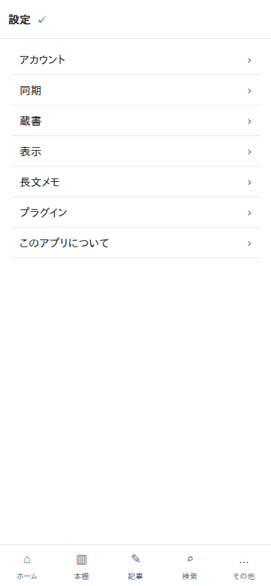 | — | 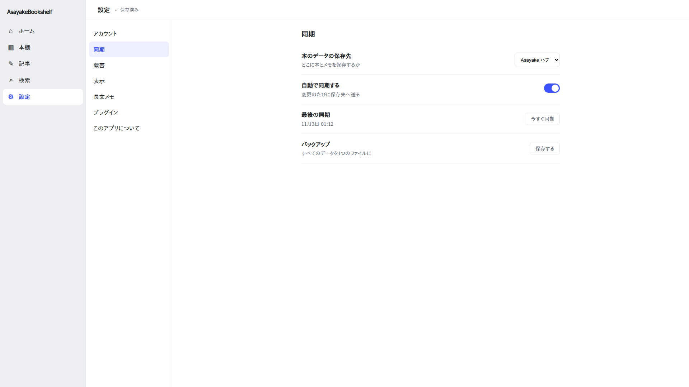 |
| 設定の中身（スマホ・← 設定） | 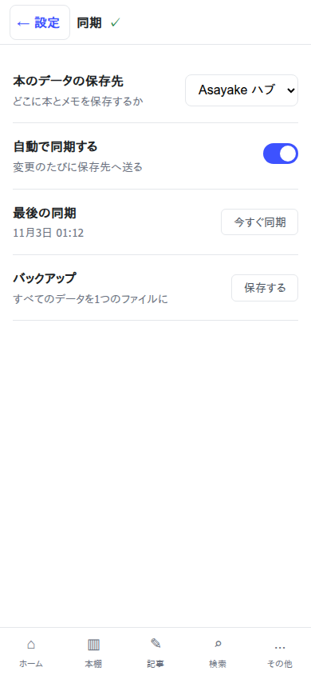 | — | — |
| 記事の一覧 |  | — | — |
| 記事の編集＋本を選ぶ | 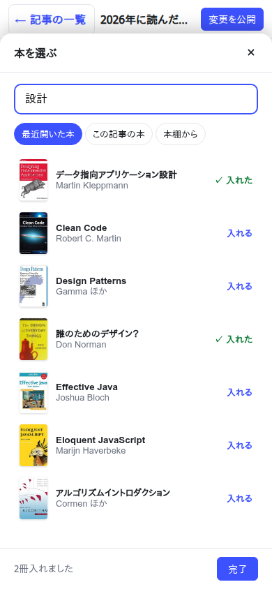 | — | 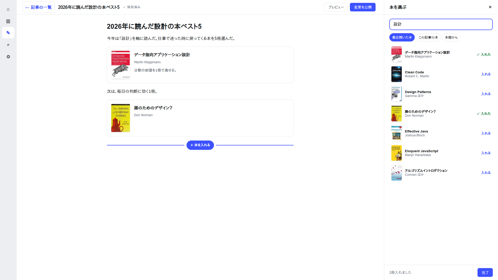 |
| 本の一覧＋本の詳細 | 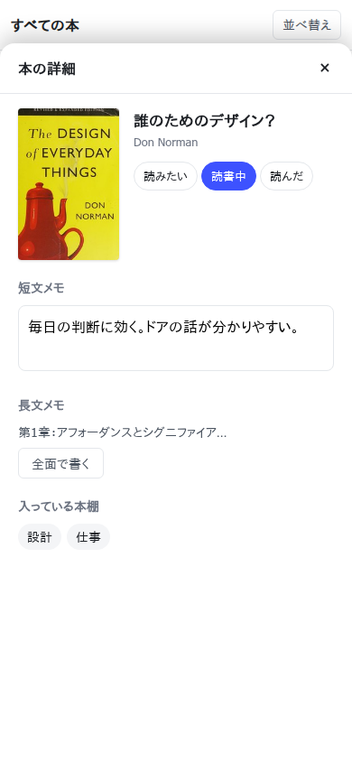 | 比較画像 compare/4 | — |

ホームの部品の編集（手順のコマ割り。入る→操作が常に見える→並べ替え→追加→外す・元に戻す）：

- スマホ 390：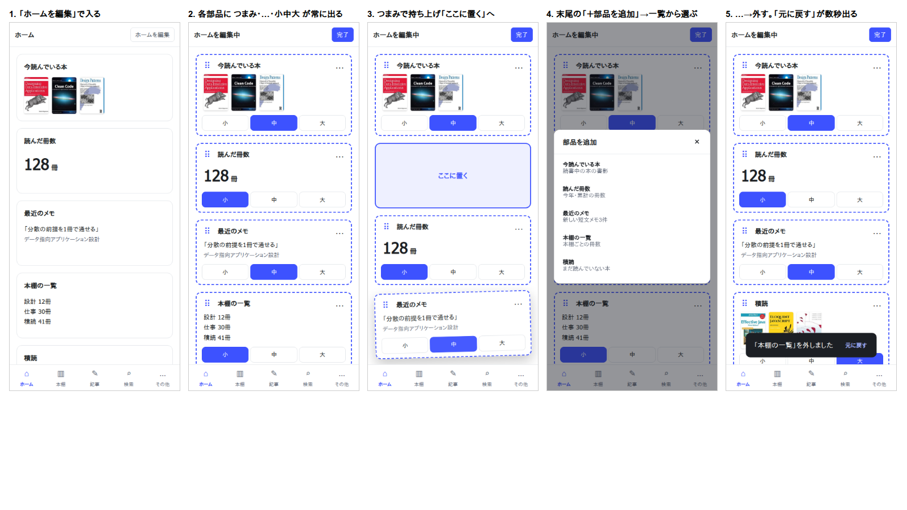
- PC：比較画像 compare/3（ホームの部分を拡大）

現状との左右比較（理想が左）：`images/497/compare/` の4枚（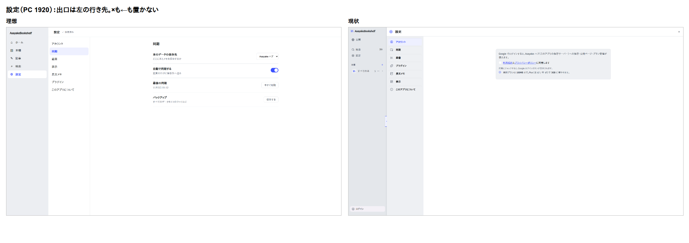 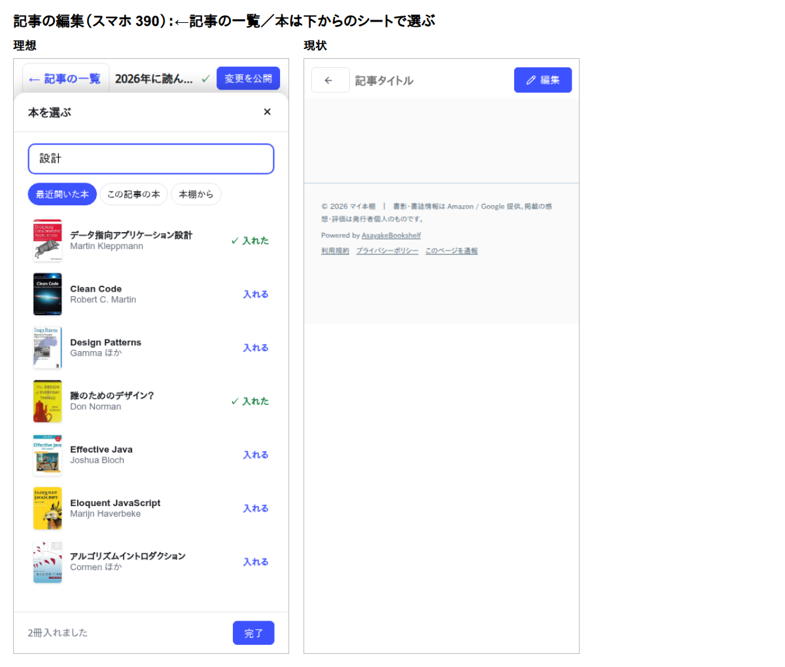 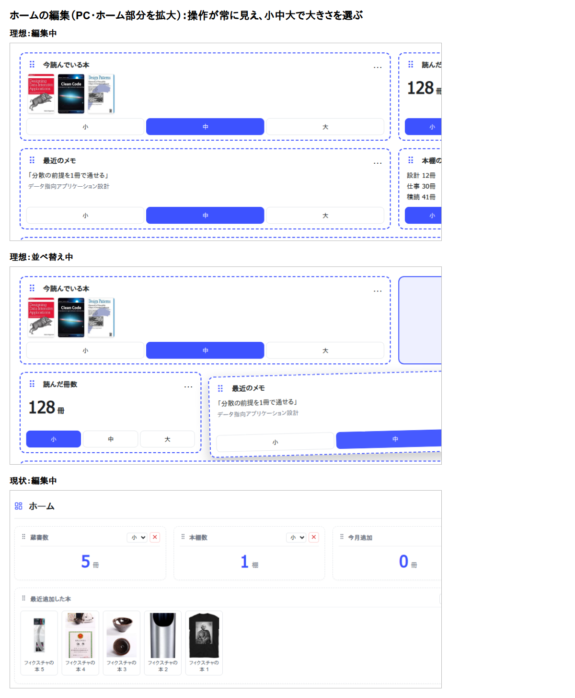 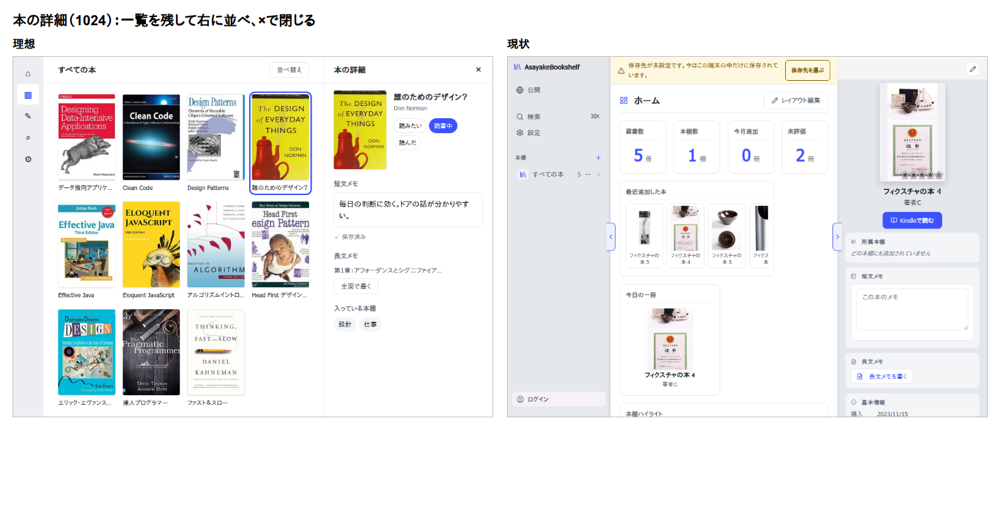）（設定 1920・記事の編集 390・ホームの編集 拡大・本の詳細 1024）。差分の表と実装の分け方は `tmp/497/497-step2-gap.md`（イシュー#497 step2）。

撮影時の検査（10画面×3幅＝30枚）：画面外への漏れ 0、切れ 0、操作部品の重なり 0、内部の注記の紛れ込み 0、書影の読み込み失敗 0。「←」の高さはすべて 44px。390 では、状態表示を ✓ の印だけにしている（帯が狭いため）。表の全体は `tmp/497/shots/checks.md`。

## §8 更新履歴

- 2026-07-27 制定（接地指示 = ledger C-256。初期内容は 2026-07-27 UI監査の検出事例＋既存規約の集約）
- 2026-07-28 C-264 の教訓還流（config 前勝ち・トラブル対処は折りたたみ・置き場所と重要度の釣り合い）
- 2026-07-29 §5 設定画面の設計方針を新設（C-271）
- 2026-07-29 §1 に除外一覧・手動追加を追加＋履歴統合の汎用ヘルパー規約（C-281。手順 UI は番号つきステップで「上から順にやれば終わる」形に）
- 2026-08-15 §1「公開ページ管理モーダル」を「公開記事モーダル」に改称（公開v2 S3、ADR-058 §11。DOM ID・開閉関数は不変のため履歴統合の実装は無変更）
- 2026-08-16 §2-10 に罫線色トークン (`--line`/`--line2`) の文字色流用禁止を追加＋§6 に stylelint・回帰テストを追記（U-4。ADR-047 P0 の個別修正が規約化されず再発したための帰納）
- 2026-08-17 §2-11 に「保存・読込の失敗を無言にしない」を新設＋§2-2 の再発事例に3回目（記事エディタの保存失敗・保存先未接続の再試行/通知ボタン）を追記（イシュー#35・ADR-063）
- 2026-08-17 §2-12 に「アンカー付きメニュー/ポップオーバーはビューポート内に収める」を新設（イシュー#42。記事エディタのブロック追加メニューが固定方向で開くためブロック数個以上で画面外に出て選べなくなっていたことの帰納）
- 2026-08-18 §6 の E2E 共通 fixture の説明に Lucide CDN・Amazon 書影の遮断を追記（イシュー#57・ADR-066。詳細な経緯・教訓は ADR-066 参照）
- 2026-08-18 §6 に E2E 共通 fixture（`tests/e2e/helpers/test-base.js`）を追記（イシュー#53・ADR-065。GIS・AdSense を実ネットワークから読んでいたことが CI の断続的な赤の原因だったため、E2E 起動時に両方をモック/遮断する共通口を新設し、全 spec をそこへ寄せた）
- 2026-08-24 §2-18 に「区切り（境目）は罫線トークンを濃くせず面差・余白・影の複合で作る」を新設（イシュー#103。#99で記事エディタ限定に留めた「面で分ける」判断をアプリ全体へ拡張し、罫線トークン(`--line`/`--line2`)自体は据え置いたまま3ペイン・モーダル・リスト等の区切りを改善した際の帰納。設計判断の詳細はADR-073）
- 2026-08-24 §2-19 に「横並び（横スクロール型）ウィジェットは表示件数を固定値で持たない」を新設（イシューU-8。`recent-books` の件数固定8件が大画面で余白を生んでいた指摘から、ウィジェットの幅3段階可変（`allowedSizes`）に対し中身の件数が追随しない枠組みの穴を帰納。縦積みウィジェットは対象外の但し書き付き。設計判断の詳細はADR-074）
- 2026-08-24 §6 に `locator.evaluate` で `getComputedStyle` 等を読む系テストの書き方規約を追加（イシュー#104。並列/CI限定フレークの真因が「DOM再構築を伴う操作の直後に計測する」構造にあったことの帰納。設計判断の詳細はADR-075）
- 2026-09-25 §1 に記事の通報ダイアログ (`#report-modal`) を追加 (イシュー#220・ADR-099)。通報の審査パネルは設定→管理者カテゴリ内 (2026-11-01 イシュー#409 でアカウントから分離・面ではないので §1 の対象外)
- 2026-09-30 §2-10 に「ホバー背景は専用トークンを使う」を追記（イシュー#247決裁1・2。`.btn-primary:hover`の`--accent-strong`流用・`.btn-danger:hover`/`.btn-warning:hover`のライト固定背景直書きが、ダークでは共用トークンの用途違いにより白文字/本文文字コントラストを割っていたことの帰納。`--btn-primary-hover-bg`等の専用トークン新設で解消。詳細はADR-106）
- 2026-11-01 §7「全体構成の原則」§7a「横展開の棚卸し」を新設（イシュー#435。#430 で公開まわりに入れた8原則をハヘロが「bookshelf内の他の部分にも横展開すべき、特に設定画面」と指示したことの帰納。旧§7更新履歴を§8に繰り上げ）
- 2026-11-02 §1 設定モーダルの行を更新（イシュー#435 step2/3。全画面ページ化で×を廃止したが、スマホ一覧は出る手段が無くなる穴があり（②差し戻し）、一覧の時だけ×を復活させる出し分けに修正したことの帰納。ADR-141）
- 2026-11-02 §7 原則6の悪い例・§7a を更新（イシュー#453。本の詳細 `.bd-meta-edit` の入れ子編集を案Aでインライン化し解消。取込 `.import-fallback-note`・プラグイン `.pcard-head` の軽い違反も解消。本棚管理モーダルの原則1違反は見送り、07_残検討事項.md の U-9 に残した。詳細は ADR-148）
- 2026-11-14 §2-11 に、保存先へのまとめ保存の失敗の出し方（`js/sync-failure.js` の1か所で種類と文言を決め、状態バーに出す・直りうる失敗は自動で再試行）と再発事例を追記（イシュー#603・ADR-158）
- 2026-11-14 §2-11 に、衝突の選択ダイアログを選ばずに閉じた後（保存先へ書かない間）も同じ1か所で「保存先へ保存していません」を出し、公開を止めることを追記（イシュー#639・ADR-162 追補。黙って戻る保存を成功とみなして表示が消えていたことの再発防止）
- 2026-11-14 §2-11 に、起動時の読み込みが通信で失敗した時の文も SyncFailure の1か所で決め、状態バーと同期欄に同じ文と「再試行」を出すことを追記（イシュー#666。ハブは状態バー・GitHub はトーストと、出す場所と文が保存先で違い、「次にどうすればよいか」も無かったことの再発防止）
- 2026-11-14 §1 衝突の選択ダイアログ: 書き込み時にも「この端末の内容で保存先を上書き」を出し、読込時と同じ3つにした（イシュー#645。GitHub は同じページのまま読み直すと古い中身が返っていたのを直してから）
- 2026-11-14 §2-11 に、設定の同期欄も状態バーと同じ1か所の文とボタンで出し、保存できていない間は「この保存先を使用中です。」を出さないことを追記（イシュー#657・ADR-158 追補。ハブ・GitHub では同期欄の文が隠れた欄に書かれ、保存できていない時も「使用中です」だけが見えていたことの再発防止）
